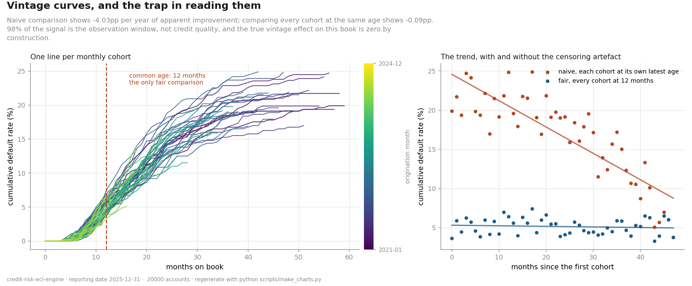
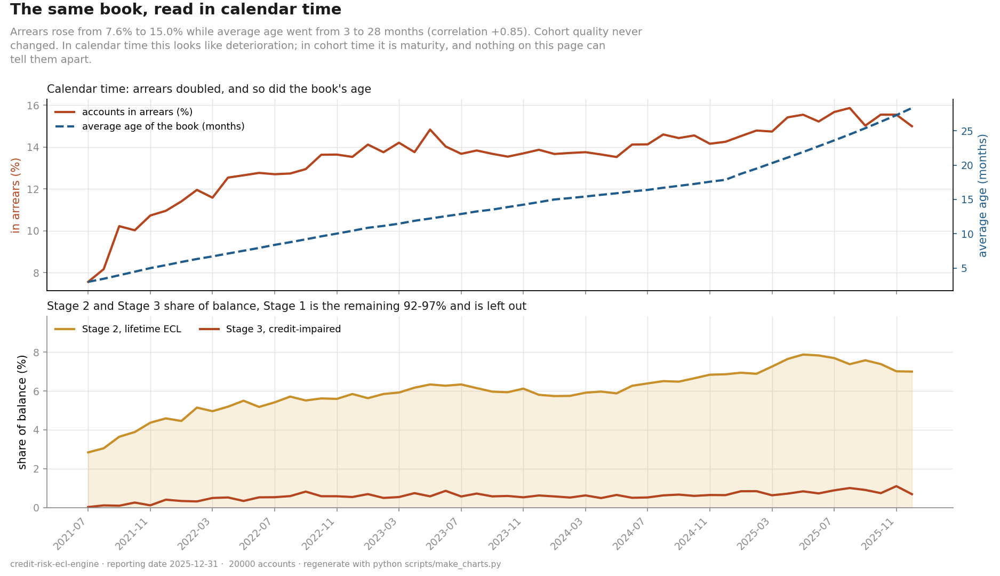

# 📊 Credit Risk ECL Engine

**An IFRS 9 expected credit loss engine over a loan book, built in SQL: data mart, delinquency roll rates, SICR staging, PD term structure, LGD and EAD, discounted ECL. Validated against an answer key that is known exactly, then reimplemented in SAS `PROC SQL` and reconciled.**


---

## The problem

Under IFRS 9 a bank provisions for losses it **expects**, not losses that have
already happened:

```
ECL = Σ  PD(t) × LGD × EAD(t) × discount(t)
```

The sum runs over the next twelve months, or over the loan's remaining
lifetime, depending on whether credit risk has increased significantly since
origination. That clause is called **staging**. It is where the accounting
judgement sits, and it is where a provision moves by multiples rather than by
percentages.

This repository builds that engine in SQL, over a loan book whose true
probability of default is known.

## Why the book is simulated

What I wanted to demonstrate here is that a calculation is correct, and that
decides the data strategy.

A real loan book gives you realism and very little else. Nobody knows its true
PD, so an engine run over it can only be compared against somebody else's
estimate. The book in this repository has delinquency driven by a Markov chain
whose transition matrix I wrote down, which means:

- true PD follows exactly from the matrix, as `(P^k)[s, default]`
- true EAD follows exactly from the annuity formula
- true LGD is drawn from a known distribution

So the engine estimates, and the answer key already knows. When the two
disagree, one of them is wrong, and finding out which is most of the work in
this project.

> My [credit default scorecard](https://github.com/esiihle/credit-default-scorecard)
> made the opposite call for the opposite reason. There the finding itself was
> the deliverable, so real data was essential, and an earlier synthetic stand-in
> produced published figures that were wrong by a factor of three. Here the
> mechanism is the deliverable. The skill is knowing which situation you are in.

Every table and report in the engine states that the book is synthetic.

## Current state: Phase 7 complete

Seven phases are built and tested: the book and its answer key, the warehouse
and CI, a data mart, roll rates, IFRS 9 staging, a **PD term structure that is
9x more accurate per account than a pooled curve**, LGD estimated from resolved
collections workouts only, an exposure schedule exact to the cent, and the
provision itself.

Per account ECL by IFRS 9 stage reconciles to the answer key at 1.8e-11.
Portfolio coverage is 4.27%, on a stage ladder of 2.2% / 25.1% / 65.1%. The
newest layer is 48 monthly vintage cohorts with the portfolio MI to read them,
which catches the usual way of reading a vintage table inventing 4pp a year of
credit improvement on a book that has none.

**137 tests pass.**

```bash
git clone https://github.com/esiihle/credit-risk-ecl-engine.git
cd credit-risk-ecl-engine
python -m venv .venv && source .venv/bin/activate
pip install -r requirements.txt

pytest                                   # 137 tests
python scripts/run_pipeline.py --sample  # runs on the committed sample book
python scripts/run_pipeline.py --status  # the build plan
python scripts/generate_book.py          # build the full book (~12s)
python scripts/make_charts.py            # regenerate docs/charts/
```

A sample book is committed, so a fresh clone runs immediately without
generating anything first.

## The build plan

| Phase | What | |
|---|---|---|
| **0** | Scaffolding, config, synthetic book and answer key, warehouse, CI | **done** |
| **1** | Data mart: `dim_account`, `dim_date`, `fact_loan_month` | **done** |
| **2** | Delinquency buckets and roll rates | **done** |
| **3** | IFRS 9 staging and the SICR rules | **done** |
| **4** | PD term structure, 12 month vs lifetime | **done** |
| **5** | LGD from resolved workouts, EAD by amortisation | **done** |
| **6** | ECL calculation and discounting at the EIR | **done** |
| **7** | Vintage curves, portfolio MI and charts | **done** |
| 8 | SAS `PROC SQL` implementation and reconciliation | next |
| 9 | Documentation and study guide | |

Phase 4 is where this project joins the scorecard: that one produces a PD, this
one consumes a PD to produce a balance sheet provision.

### What Phase 5 found

LGD is the only genuinely uncertain input in the whole engine. Exposure is
arithmetic. PD rests on half a million observed transitions. LGD rests on a few
thousand defaults, each of which takes about a year to resolve. and that is
where the trap is.

| | defaults | mean loss |
|---|---|---|
| resolved workouts | 2,288 | **65.10%** |
| unresolved workouts | 959 | 77.05% |
| all defaults, the naive estimate | 3,247 | 68.63% |
| **truth** | | **65.1%** |

An account that defaulted last month has barely started collections. Its loss
to date is not its LGD. It is its LGD plus however much is still to come.
Averaging those cases in overstates the loss by 3.5 points, and the bias always
runs the same way, towards a bigger provision, because that is what the
mechanism does.

It is the same shape as the Phase 2 roll rate trap by a different route. There
the bias came from the end of an account's series; here it comes from the start
of a workout. Both include observations whose outcome is not yet known.

Phase 5 also caught CI passing **on the luck of the seed**. The absolute LGD
gate passed on the committed sample at 0.0189 against a limit of 0.0200. Across
six seeds at that book size, one passed and five failed, while the gate that
accounts for sample size passed on all six. A 2pp materiality limit means
nothing when the standard error is 4pp, so that gate now reports `not assessed`
below a precision requirement. The decision is made from the sample before any
error is computed, and a test reads the function's own source to keep it that
way. Methodology §6.4 has the detail.

### What Phase 6 found

**The answer key had no provision against its own defaulted book.** It recorded
all 61 credit impaired accounts at a lifetime PD of 1.00 and an ECL of exactly
0.00, which is R939k of defaulted exposure with nothing behind it. The cause was
one line. ECL was built from the probability of defaulting in each future month,
and default is absorbing, so for an account already in default every one of
those increments is zero. The formula was correct about what it computes; it was
being asked a question it does not answer. Had I built the engine to agree with
the key, it would have shipped provisioning nothing against its defaults.

**One tolerance was answering two questions.** The 2% ECL gate set back in Phase
0 could not be met by correct code. ECL is a product of three estimated inputs,
so its relative error is roughly the sum of theirs, and the Phase 4 PD gate
alone permits 15%. The ECL gate was 7.5x stricter than the input it inherits
from, while also being loose enough that a sum formed wrongly (cumulative PD,
the wrong horizon, no discounting) could still pass. It is now two gates: an
exact reconciliation of the arithmetic on true inputs, which lands at
**1.8e-11**, and a 15% backstop on end to end accuracy. Methodology §7.3.

**The staging cliff is steepest for the accounts least likely to cross it.**
Both horizons are computed for every account, so the jump at the SICR boundary
is measurable on the same accounts in the same month, counted two ways:

| arrears bucket | accounts | lifetime ÷ 12 month |
|---|---|---|
| 0 (current) | 6,957 | **1.633** |
| 1 (1 to 29 DPD) | 853 | 1.198 |
| 2 (30 to 59 DPD) | 258 | 1.030 |
| 3 (60 to 89 DPD) | 127 | **1.004** |

An account 60 to 89 days down will mostly default inside twelve months either
way, so extending its horizon to lifetime adds 0.4%. The accounts that actually
trip the 30 day backstop face the smallest jump. The large discontinuity is
reserved for accounts that cross via the PD trigger while still current, and
Phase 3 measured that trigger as barely firing. So the cliff is real, and on
this book it is mostly hypothetical.

**Assessability has to propagate.** Rehearsing CI in a clean room caught the
400 account sample failing the ECL accuracy backstop at -15.4%, while the same
run printed `--` for both PD gates and the LGD gate, meaning not assessed. The
engine was delivering a verdict on a figure computed from estimates it had just
said it had no evidence about. The rule now is that if the inputs could not be
assessed, the output cannot be either. The arithmetic gate is unaffected,
because it substitutes exact inputs and holds at any book size. Methodology
§7.6.

**The residual 2.25% is PD, not LGD.** Substituting each account's true LGD for
the segment estimate moves the portfolio total by 0.26%. The gap is PD
estimation error, mostly the cost of approximating a continuous seasoning hazard
with five discrete age bands. The engine under provisions rather than over
provisions, which is the direction worth saying out loud.

### What Phase 7 found



**The usual way of reading a vintage table invents a trend that is not there.**
Show every cohort at its own latest age and the line slopes down at **-4.03pp
per year**, with a correlation of -0.85. Four straight years of apparent credit
improvement, which is the kind of number that gets a lending policy loosened.
Compare every cohort at the same age instead and the slope is **-0.09pp per
year**. **97.8% of the signal is the observation window**, and the true vintage
effect on this book is zero by construction, because segment and origination
month are drawn independently.

That is the third appearance of one mechanism. Phase 2's roll rates were biased
by the end of an account's series, Phase 5's LGD by the start of a workout, and
this by the end of the observation window. Each time the naive denominator
included outcomes that had not happened yet.

**Monthly cohorts could not have detected a real effect anyway.** The spread
between cohorts is indistinguishable from chance: observed SD ÷ expected SD =
0.948, chi square p = 0.659. More useful than that is what the book could have
detected at 80% power, which is **4.29pp with monthly cohorts**, 2.48pp
quarterly and 1.24pp annual. Against a 5.16% base rate, a monthly triangle
cannot see anything smaller than 83% of the base rate itself. The right response
to a noisy monthly chart is to group the cohorts, not to explain the wiggles.

**Calendar time shows a deterioration that is only the book growing up.**



Arrears went from 7.56% to 15.00% while the average age of the book went from
3.0 to 28.3 months, a correlation of +0.85. Cohort quality never changed. This
is the age, period and cohort identification problem in its simplest form: age
plus vintage equals period exactly, so the three effects cannot be separated
from observational data without an outside assumption. Here two of them are zero
by construction, which is the only reason the decomposition can be checked at
all. On a real book it cannot be, and the honest thing to tell a committee is
that calendar movement has at least two explanations and the data will not
choose between them.

## Two implementations, reconciled

Phase 8 reimplements the engine in SAS `PROC SQL`, which is what South African
bank credit risk teams actually run, and reconciles it against the DuckDB
reference account by account, to a tolerance set in `config.yaml` before either
side was built.

This is not a workaround for not having a SAS licence during development. It is
champion and challenger reconciliation, which is what a model validation
function does, and it is the only way to show that the SAS code is correct
rather than assert it.

## Repository structure

```
config.yaml     every threshold and accounting policy choice, in one readable place
src/            config, generate (the book and its answer key), db (DuckDB harness),
                mart, rollrate, staging, pd, lgd, ecl, vintage: one module per phase
sql/            the engine's logic as SQL, readable and reviewable and portable
scripts/        generate_book.py · run_pipeline.py · make_charts.py
tests/          137 tests; the answer key is checked against the simulation,
                every mart quality check is shown to fail when it should, and
                the known biases are asserted to still be there
docs/           OVERVIEW · ROADMAP · methodology · charts
data/sample/    a small committed book so a clone runs out of the box
.github/        CI: the suite plus a pipeline run, on Python 3.11 and 3.12
```

## How this project handles numbers

No figure appears in any document unless a command regenerates it. Thresholds go
into `config.yaml` before results are known, because a limit that moves to
accommodate an outcome was never a limit. Both habits are here for a reason: on
my scorecard project I once published numbers typed into a comment that were
wrong by a factor of three, and they survived a green test suite for two days.

## Author

**Sihle Myeza**, BSc Computer Science (Wits), data analyst working towards
quantitative and credit risk roles. Built in the open, one commit at a time.

## License

MIT. See [`LICENSE`](LICENSE).
