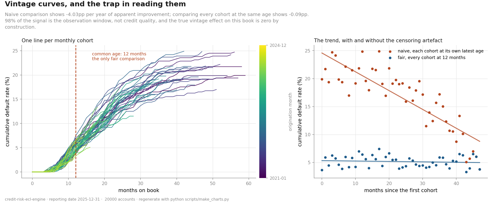
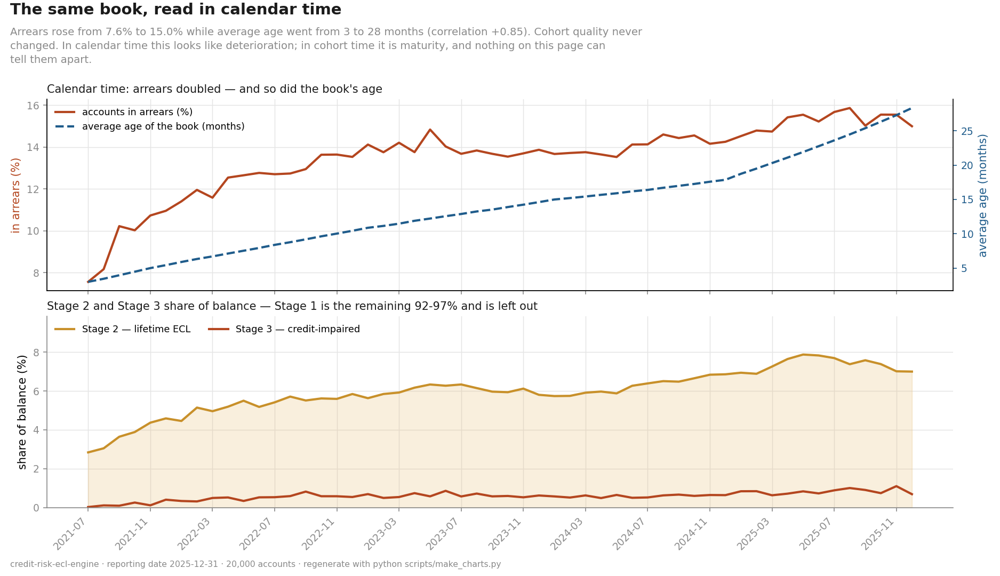

# 📊 Credit Risk ECL Engine


An IFRS 9 expected credit loss engine for a loan book, written in SQL. It covers the data mart, delinquency roll rates, SICR staging, the PD term structure, LGD, EAD and the discounted ECL. I check every result against an answer key that is known exactly, and I'm now rebuilding the engine in SAS `PROC SQL` so the two versions can be reconciled.


## Where it stands

Phases 0 to 7 are built and tested. Phase 8, the SAS version, is in progress.

- Per-account ECL by IFRS 9 stage reconciles to the answer key at 1.8e-11.
- Portfolio coverage is 4.27%, with a stage ladder of 2.2% / 25.1% / 65.1%.
- A per-account PD term structure is 9x more accurate than a pooled curve.
- LGD is estimated from resolved collections workouts only.
- 161 tests pass, run in CI on Python 3.11 and 3.12.

## Run it

```bash
git clone https://github.com/esiihle/credit-risk-ecl-engine.git
cd credit-risk-ecl-engine
python -m venv .venv && source .venv/bin/activate
pip install -r requirements.txt

pytest                                   # 161 tests
python scripts/run_pipeline.py --sample  # runs on the committed sample book
python scripts/run_pipeline.py --status  # shows the build plan
python scripts/generate_book.py          # builds the full book (~12s)
python scripts/make_charts.py            # regenerates docs/charts/
```

A small sample book is committed, so a fresh clone runs straight away.

## What it calculates

Under IFRS 9 a bank provisions for the losses it expects, not only the ones that have already happened:

```
ECL = Σ  PD(t) × LGD × EAD(t) × discount(t)
```

The sum runs over the next twelve months, or over the loan's remaining lifetime if its credit risk has increased significantly since origination. That rule is called staging. Most of the accounting judgement sits there, and it's where a provision can move by multiples rather than by percentages.

## Why the loan book is simulated

I wanted to show that the calculation is correct, and that decided the data.

Nobody knows the true PD of a real loan book, so an engine run over one can only be compared with somebody else's estimate. In this book, delinquency follows a Markov chain whose transition matrix I wrote down. That means:

- true PD follows exactly from the matrix, as `(P^k)[s, default]`
- true EAD follows exactly from the annuity formula
- true LGD is drawn from a known distribution

The engine estimates and the answer key already knows. When they disagree, one of them is wrong, and working out which one was most of the work.

My [credit default scorecard](https://github.com/esiihle/credit-default-scorecard) went the other way. There the finding was the point, so I needed real data. An earlier synthetic version of that project produced figures that were wrong by a factor of three. Every table and report in this engine says that the book is synthetic.

## Build plan

| Phase | What | Status |
|---|---|---|
| 0 | Scaffolding, config, synthetic book and answer key, warehouse, CI | done |
| 1 | Data mart: `dim_account`, `dim_date`, `fact_loan_month` | done |
| 2 | Delinquency buckets and roll rates | done |
| 3 | IFRS 9 staging and the SICR rules | done |
| 4 | PD term structure, 12-month vs lifetime | done |
| 5 | LGD from resolved workouts, EAD by amortisation | done |
| 6 | ECL calculation and discounting at the EIR | done |
| 7 | Vintage curves, portfolio MI and charts | done |
| 8 | SAS `PROC SQL` implementation and reconciliation | in progress |
| 9 | Documentation and study guide | in progress |

Phase 4 is where this project meets the scorecard: the scorecard produces a PD, and this engine uses a PD to produce a provision.

## What I found along the way

### LGD: unfinished workouts inflate the estimate (Phase 5)

LGD is the least certain input in the engine. Exposure is arithmetic and PD rests on half a million observed transitions, but LGD rests on a few thousand defaults that each take about a year to resolve.

| | defaults | mean loss |
|---|---|---|
| resolved workouts | 2,288 | 65.10% |
| unresolved workouts | 959 | 77.05% |
| all defaults (naive estimate) | 3,247 | 68.63% |
| truth | | 65.1% |

An account that defaulted last month has barely started collections, so its loss to date isn't its final loss. Including those accounts overstates LGD by 3.5 points, and always in the direction of a bigger provision.

This phase also showed CI passing on a lucky seed. The absolute LGD gate passed on the sample at 0.0189 against a limit of 0.0200, but across six seeds at that book size only one passed. A 2pp limit means little when the standard error is 4pp, so that gate now reports `not assessed` when the sample is too small. Methodology §6.4 has the detail.

### ECL: the answer key had a bug (Phase 6)

The answer key recorded all 61 defaulted accounts with a lifetime PD of 1.00 and an ECL of 0.00, leaving R939k of defaulted exposure with no provision. ECL was built from the probability of defaulting in each future month, and an account already in default can't default again, so every one of those increments was zero. If I had built the engine to match the key, it would have provisioned nothing against defaulted loans.

I also split one tolerance into two. The original 2% ECL gate couldn't be met by correct code, because ECL inherits the errors of three estimated inputs and the PD gate alone allows 15%. It's now an exact check of the arithmetic on true inputs (1.8e-11) plus a 15% check on end-to-end accuracy. Methodology §7.3.

The jump in ECL at the staging boundary is smallest for the accounts most likely to cross it:

| arrears bucket | accounts | lifetime ÷ 12-month |
|---|---|---|
| 0 (current) | 6,957 | 1.633 |
| 1 (1 to 29 DPD) | 853 | 1.198 |
| 2 (30 to 59 DPD) | 258 | 1.030 |
| 3 (60 to 89 DPD) | 127 | 1.004 |

An account 60 to 89 days behind will mostly default within twelve months either way, so moving it to a lifetime horizon adds only 0.4%. The big jump only applies to current accounts that move stage through the PD trigger, and Phase 3 showed that trigger rarely fires on this book.

The remaining 2.25% gap to the truth comes from PD, not LGD. Swapping in each account's true LGD moves the total by only 0.26%. Most of the gap comes from approximating a smooth seasoning curve with five age bands. The engine under-provisions slightly rather than over-provisioning.

### Vintages: the usual reading invents a trend (Phase 7)



If you compare each cohort at its latest age, default rates appear to fall by 4.03pp a year, which looks like four years of improving credit quality. Compared at the same age, the slope is -0.09pp a year. 97.8% of the apparent trend comes from the observation window, and the true vintage effect on this book is zero by design.

That's the same mistake I hit with roll rates in Phase 2 and LGD in Phase 5: the calculation included outcomes that hadn't happened yet.

Monthly cohorts couldn't have picked up a real effect anyway. The smallest difference the book could detect at 80% power is 4.29pp with monthly cohorts, 2.48pp with quarterly and 1.24pp with annual. With a base rate of 5.16%, it's better to group the cohorts than to explain the wiggles in a monthly chart.



In calendar time, arrears rose from 7.56% to 15.00% while the book's average age went from 3.0 to 28.3 months. Cohort quality never changed; the book just got older. On a real book you can't fully separate age, period and cohort effects, so calendar movement always has more than one possible explanation.

## The SAS version

South African bank credit risk teams mostly work in SAS, so I'm rewriting the engine in `PROC SQL` and reconciling it row by row against the DuckDB version. The tolerance was set in `config.yaml` before either side was built. The SAS engine reads only the three source CSVs, with no intermediate tables or answer key, so if the two versions agree, it's because each got the same answer independently.

`PROC SQL` has no window functions or recursive CTEs, so four constructs had to be rebuilt:

| DuckDB | SAS replacement |
|---|---|
| `LAG(is_default) OVER (...)` | left self-join onto month t-1 |
| `LEAD(arrears_bucket) OVER (...)` | inner self-join onto month t+1 |
| `MAX(...) OVER (ROWS BETWEEN n PRECEDING ...)` | range self-join and `GROUP BY` |
| `WITH RECURSIVE` | a `%macro` loop adding one horizon at a time |

I tested each replacement as plain SQL in DuckDB before writing any SAS. The loop matches the recursive CTE exactly, and the three self-joins give zero mismatches across 506,213 account-months.

I don't have SAS on my machine, so the `sas/*.sas` files can't be run in CI. Instead, the logic is tested in DuckDB as described above, and each SAS program is checked for constructs `PROC SQL` doesn't support. That catches the most likely mistake, using a DuckDB feature out of habit, but it can't prove the code runs. Methodology §9.4 lists what that leaves untested.

## Repository layout

```
config.yaml     every threshold and accounting policy choice in one place
src/            one module per phase: generate, db, mart, rollrate, staging,
                pd, lgd, ecl, vintage
sql/            the engine's logic as SQL
sas/            the same engine in SAS PROC SQL
scripts/        generate_book.py, run_pipeline.py, make_charts.py,
                export_for_sas.py, reconcile_sas.py
tests/          161 tests, including checks that each data quality rule
                fails when it should
docs/           overview, roadmap, methodology and charts
data/sample/    a small committed book so a clone runs immediately
.github/        CI on Python 3.11 and 3.12
```

## Further reading

- [`docs/methodology.md`](docs/methodology.md): the full method for each phase, with the reasoning behind every threshold.
- [`docs/STUDY_GUIDE.md`](docs/STUDY_GUIDE.md): my notes for explaining the project, including its weaknesses and the questions I expect.

## How I handle numbers

Every figure in these docs can be regenerated by a command. Thresholds go into `config.yaml` before results are known, so a limit never moves to fit an outcome. I started doing this after my scorecard project, where I published numbers that were wrong by a factor of three, and they got past a passing test suite for two days.

## Author

Sihle Myeza. BSc Computer Science (Wits), data scientist.


## License

MIT. See [`LICENSE`](LICENSE).
